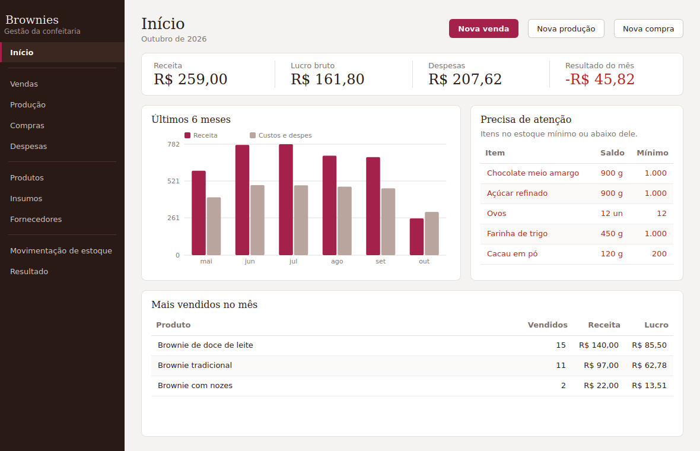
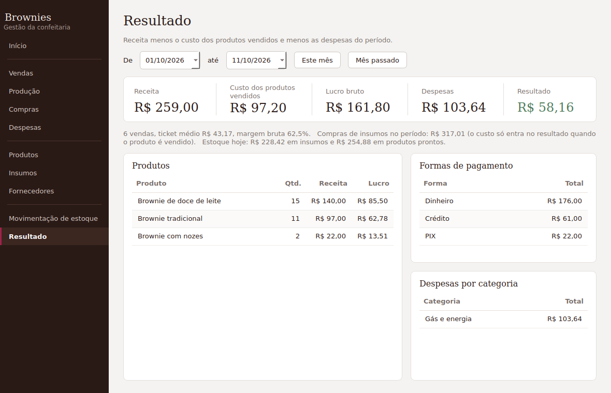

# Gestão de Brownies

Sistema desktop para administrar uma confeitaria pequena: **insumos, fichas técnicas, compras, produção, vendas, despesas e resultado do mês**. Funciona offline, sem servidor e sem custo: os dados ficam num arquivo SQLite no computador.



## O que ele faz

| Área | Regras (no estilo de um ERP simples) |
|---|---|
| **Insumos** | Unidade fixa depois da primeira movimentação; estoque mínimo com alerta; nome único; inativar em vez de excluir. |
| **Produtos e ficha técnica** | A ficha define o que vai em *um lote*; custo e margem calculados pelos custos médios atuais; aviso quando o preço está abaixo do custo. |
| **Compras** | Entrada de estoque com **custo médio ponderado**; cancelamento estorna o estoque (bloqueado se o insumo já foi usado). |
| **Produção** | Consome os insumos da ficha, gera produto pronto e calcula o custo real do lote; bloqueia e lista tudo o que faltar. |
| **Vendas** | Baixa o produto pronto, aceita desconto e **congela o custo no dia da venda** (o lucro não muda quando o preço do insumo muda). |
| **Estoque** | Saldo nunca fica negativo; toda alteração gera um lançamento (kardex) com o documento de origem; contagem de estoque e registro de perdas. |
| **Despesas** | Gás, taxas, transporte etc. Ingredientes entram por Compras, não aqui. |
| **Resultado** | Receita − custo dos produtos vendidos − despesas, por período; mais vendidos, formas de pagamento e despesas por categoria. |



## Tecnologias

- **Python 3.10+**, **PySide6** (Qt) para a interface
- **SQLite** com **SQLAlchemy 2.0** e migrações **Alembic** (aplicadas automaticamente ao abrir o app)
- **pytest** para as regras de negócio; **GitHub Actions** para rodar os testes

## Arquitetura

```
src/brownie_erp/
├── models.py        # tabelas (SQLAlchemy)
├── money.py         # Decimal exato; valores guardados como inteiros escalados
├── services/        # regras de negócio, sem nada de interface
│   ├── estoque.py   #   único ponto que altera saldo (+ custo médio, kardex)
│   ├── compras.py  producao.py  vendas.py  despesas.py  cadastros.py
│   └── relatorios.py  precificacao.py
├── migrations/      # Alembic
├── ui/              # PySide6: tema, widgets, diálogos e páginas
└── demo.py          # dados de exemplo
```

Decisões:
- **Dinheiro e quantidades em `Decimal`**, gravados como inteiros (× 1.000.000): sem erro de ponto flutuante e `SUM` correto em SQL.
- **Serviços não conhecem a interface**: todas as regras têm teste automatizado sem abrir janela.
- **Nada importante é apagado**: cadastros são inativados; documentos são cancelados com estorno.
- **Cancelamentos usam os movimentos originais**, não a ficha técnica atual (a ficha pode ter mudado desde a produção).

## Como rodar

```bash
python -m venv .venv
source .venv/bin/activate        # Windows: .venv\Scripts\activate
pip install -e ".[dev]"

python -m brownie_erp            # abre o app com o banco vazio
python -m brownie_erp --demo     # carrega dados de exemplo (só se o banco estiver vazio)
pytest                           # testes
```

O banco fica em `%APPDATA%\BrownieERP\brownie.db` (Windows), `~/.local/share/BrownieERP` (Linux) ou `~/Library/Application Support/BrownieERP` (macOS). Para usar outra pasta (por exemplo, uma sincronizada com a nuvem), defina `BROWNIE_ERP_DATA`. Ao fechar o app, é criado um backup em `backups/` (os 15 mais recentes são mantidos).

Nova migração depois de mudar `models.py`:

```bash
alembic revision --autogenerate -m "descrição"
```

## Gerar o executável (Windows)

```bash
pyinstaller --noconsole --name GestaoBrownies --paths src ^
  --add-data "src/brownie_erp/migrations;brownie_erp/migrations" src/brownie_erp/__main__.py
```

## Limitações conhecidas

- Cancelar compra recalcula o custo médio removendo o valor da compra; é uma aproximação quando houve consumo depois.
- Compra e ficha usam a unidade base do insumo (g, ml, un). Não há conversão automática (kg → g).
- Um único usuário; sem controle de acesso.

## Próximos passos

- [ ] Cadastro de clientes e contas a receber (venda fiado/encomenda)
- [ ] Encomendas com data de entrega
- [ ] Conversão de unidades na compra (kg → g)
- [ ] Exportar relatórios para Excel/CSV
- [ ] Preço sugerido a partir da margem desejada (a regra já existe em `precificacao.py`)
